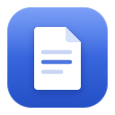
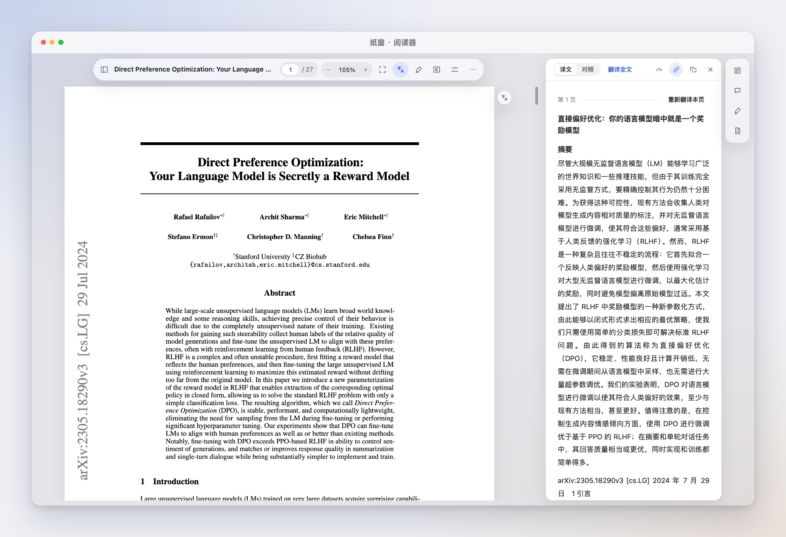
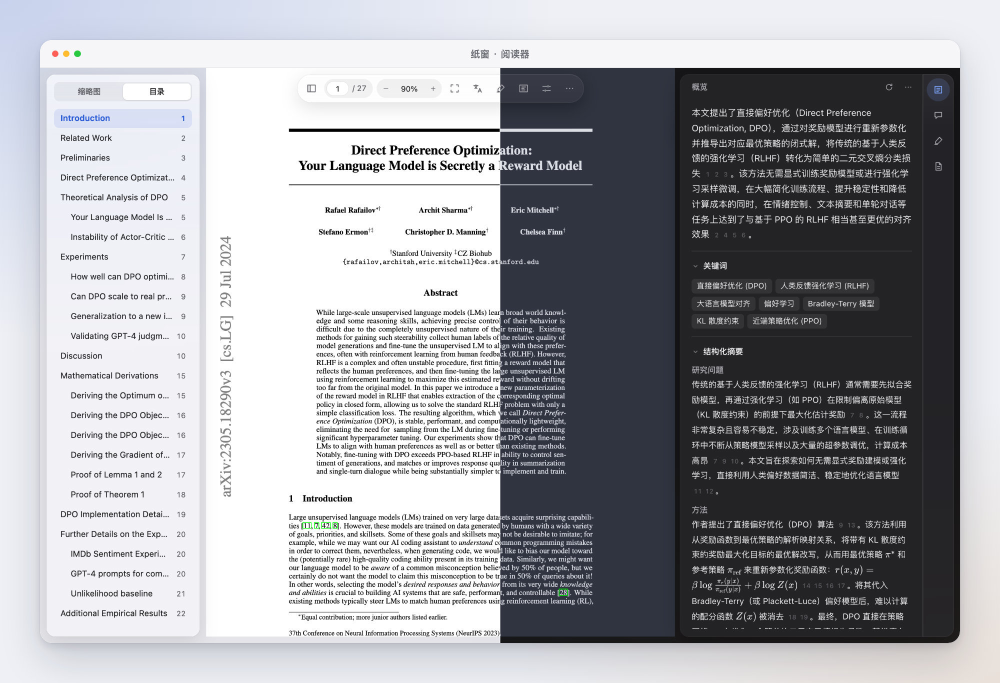
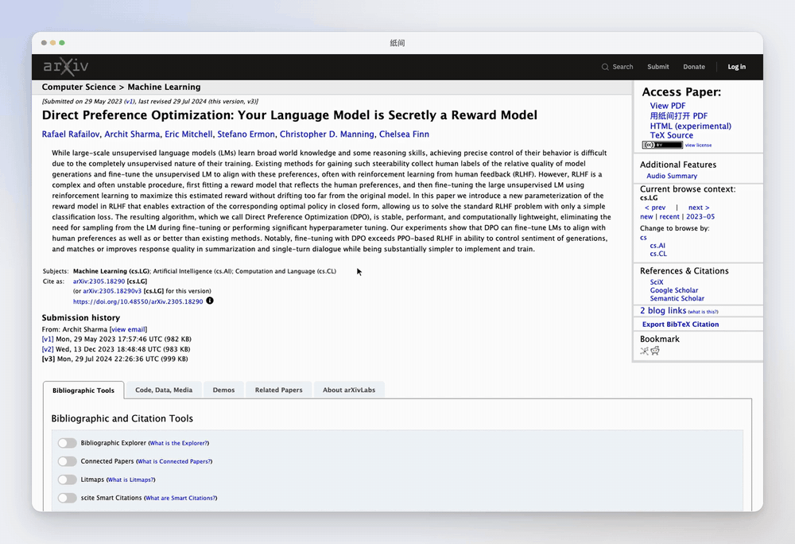
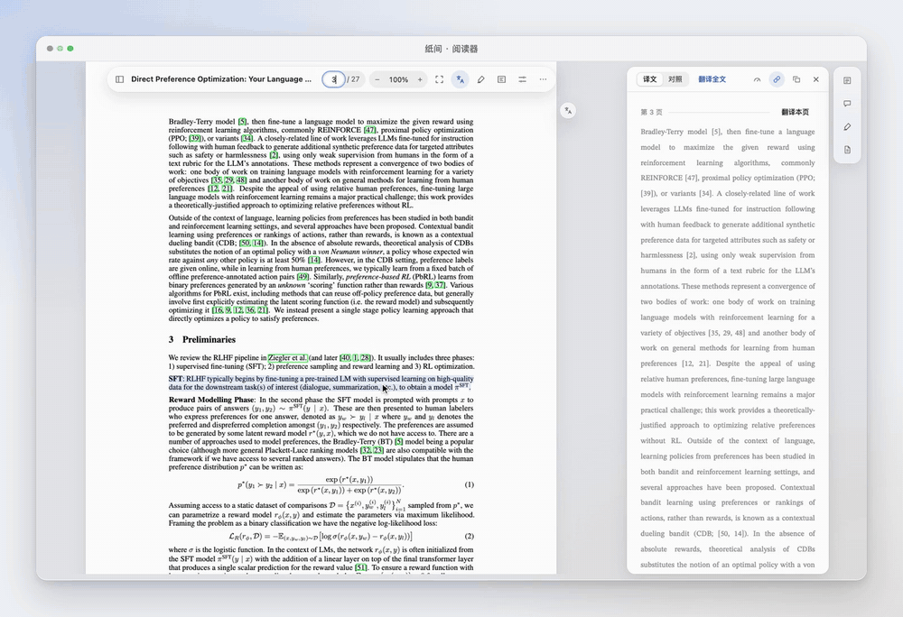
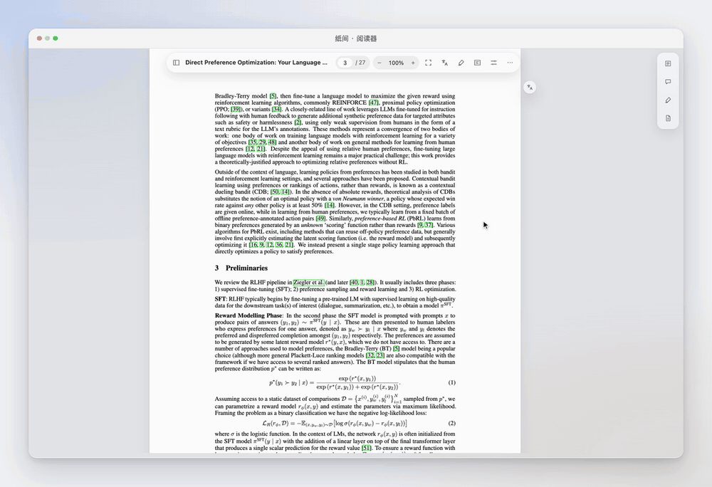
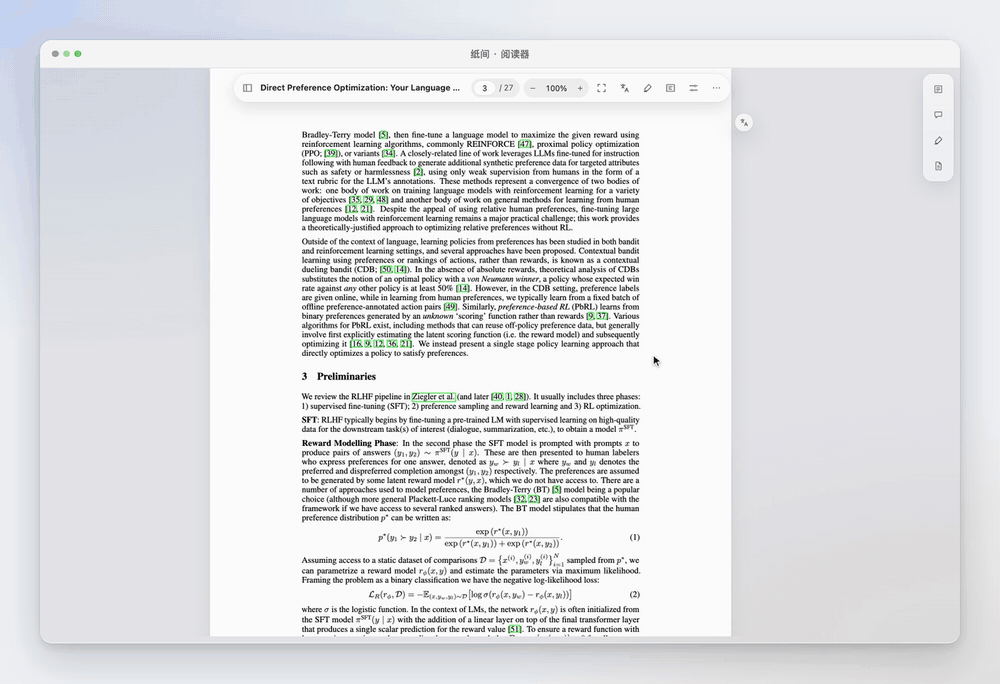
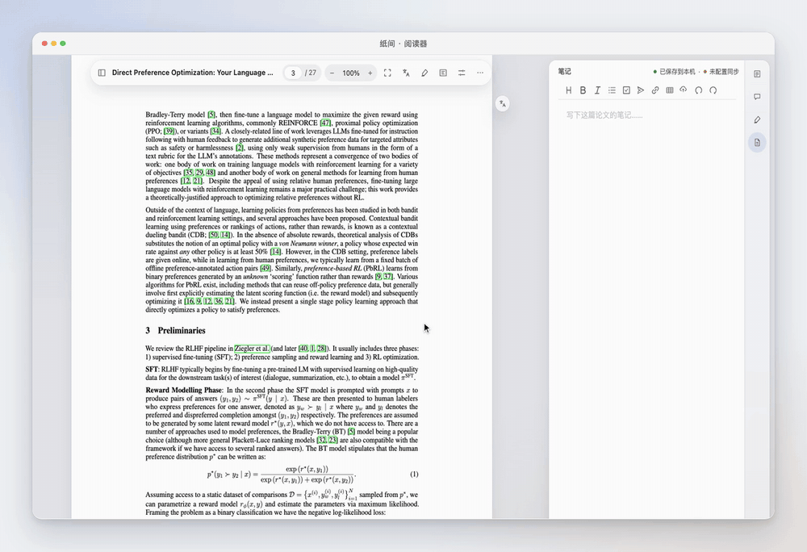
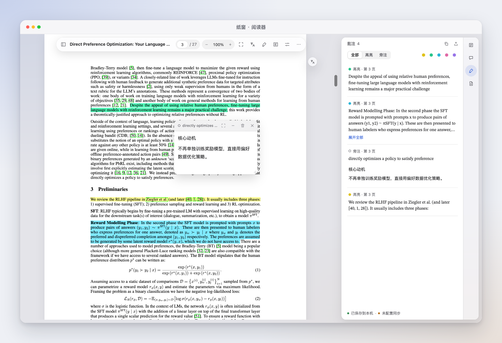
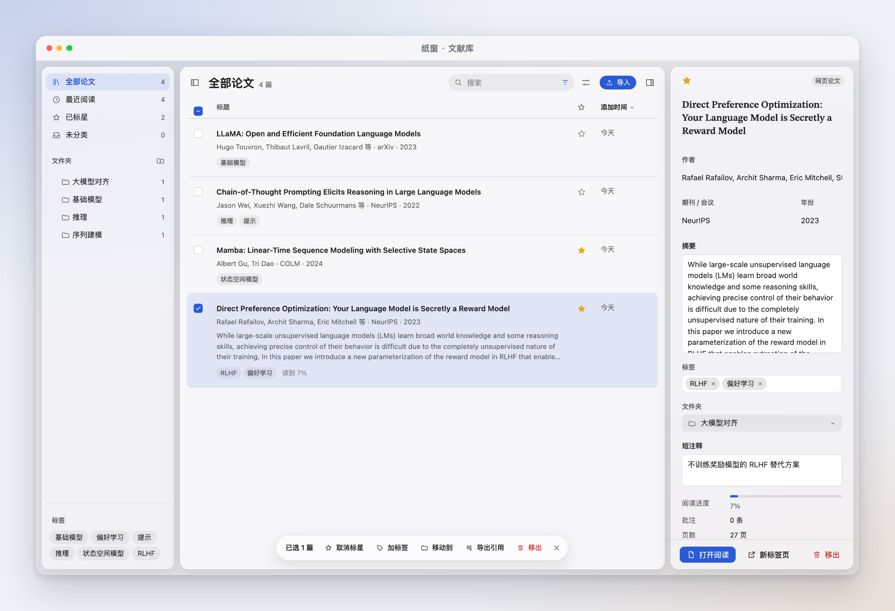

<div align="center">



<h1>纸窗 Paperpane</h1>

<p><b>在浏览器里读论文：对照翻译，随手提问。</b></p>

<p>
  
  
  
  
</p>

<p>
  <a href="#功能">功能</a> ·
  <a href="#安装">安装</a> ·
  <a href="#隐私与费用">隐私与费用</a> ·
  <a href="#常见问题">常见问题</a> ·
  <a href="docs/DEVELOPMENT.md">参与开发</a>
</p>



</div>

<br />

<div align="center">
<table>
  <tr>
    <td align="center" width="25%"><br /><b>一键打开</b><br /><sub>论文网页上直接打开，<br />自动整理概览</sub></td>
    <td align="center" width="25%"><br /><b>对照翻译</b><br /><sub>整篇对照，划选即译；<br />大模型或翻译服务</sub></td>
    <td align="center" width="25%"><br /><b>解释与提问</b><br /><sub>回答标明出处，<br />点一下回到原文</sub></td>
    <td align="center" width="25%"><br /><b>文献库</b><br /><sub>批注、笔记、文件夹，<br />WebDAV 同步</sub></td>
  </tr>
</table>
</div>

## 为什么做纸窗

- 浏览器自带的 PDF 阅读器只能看，读到一半想翻译、想查一个概念，就得在好几个窗口之间来回切。
- 网页翻译插件会把排版打乱，公式和图表也跟着被「翻译」。
- 问 AI 要先复制、再粘贴、再解释上下文，回答也很难对回原文的哪一句。

纸窗把这些放进同一个阅读器里：论文始终在中间，翻译、解释、提问和笔记都贴着原文出现。

## 安静的阅读界面



界面只在需要时出现。工具栏、侧栏和研究区都是半透明的玻璃材质，论文本身始终是主角。浅色、深色跟随系统；深色模式下论文页面也会一起变暗，夜里读不刺眼。

## 功能

### 1. 一键打开，快速了解论文

在 arXiv、Google Scholar、OpenReview 等论文网站，PDF 链接旁会出现「用纸窗打开」。点一下，论文进入阅读器，同时收进文献库，右侧开始整理概览。



- **概览**：一段话的总结、关键词、研究问题、方法、结论和要点，每条都带出处编号，点一下跳到原文。
- **不止 arXiv**：支持十几个常见论文网站，网页里的普通 PDF 链接和嵌入的 PDF 也能打开；本地 PDF 可以直接导入。
- **自动识别目录**：没有书签的论文也会按章节生成目录。

### 2. 对照翻译

翻译以页为单位进行，译文排在右侧的译文栏，跟着你的阅读位置走。可以只看译文，也可以切到「对照」，一句原文配一句译文。



- **划选即译**：选中一句话，点「翻译」，结果出现在原文旁边的小窗里。
- **两种引擎**：大模型译得更通顺；谷歌、DeepL、微软、百度等翻译服务更快、更便宜。全文和划选可以分开选择引擎。
- **公式和图表不动**：公式、图表保持原样，点「查看原文」回到论文。
- **可以自动翻译**：添加或打开论文时自动翻译全文，默认关闭；会请求模型或翻译服务时，会先告诉你可能产生费用。

### 3. 一键解释，划选提问

读不懂的段落，选中后点「解释」；想追问，就点「提问」，选中的文字会作为引用带进对话。





- **回答有出处**：句末的小数字指向论文原文，点一下就能对照。
- **结合整篇论文**：模型会先读论文，再回答，不只看你选中的那几行。
- **框选提问**：图表、流程图也能问，框选一块区域即可。
- **每个功能可用不同的模型**：比如提问用推理强的模型，解释用便宜快速的模型。

### 4. 元素自动识别，公式一键复制

纸窗在本机识别论文里的公式、表格和图片。鼠标移上去就能复制：公式复制为 LaTeX，表格复制为 Markdown、LaTeX 或 Excel，图片复制为图片。



- **识别在本机完成**：版面识别模型随扩展一起安装，不上传论文。
- **公式转写更准**：公式由支持图片的模型转写成 LaTeX，可以在打开论文时提前转写，复制时立即可用。
- **格式随你**：LaTeX 的定界符（`\( \)`、`$ $` 或不加）可以在设置里选。

### 5. 批注与笔记

五种颜色的高亮、贴在原文旁的旁注便签，以及每篇论文一份 Markdown 笔记。



- **旁注跟着论文走**：便签贴在原文旁，缩放、翻页、换布局都不会跑位。
- **批注列表**：按颜色和类型筛选，点一条回到原文。
- **笔记支持公式**：所见即所得的 Markdown，粘贴的公式会直接排版。
- **导出**：批注可以导出为 Markdown 或 CSV，也可以连同批注一起打印。

### 6. 文献库与同步

读过的论文都在文献库里，可以按文件夹、标签、星标整理，按标题、作者、摘要搜索。



- **WebDAV 同步**：连接坚果云、Nextcloud 等 WebDAV 服务，在多台电脑之间同步论文、批注和笔记；服务器不支持可靠同步时可以只做云备份。
- **完整备份**：一键导出包含 PDF、书目、批注和笔记的备份包，可以在新的浏览器里恢复。
- **Zotero 往返**：从 Zotero 个人库导入论文和批注，也可以把论文和高亮导出回 Zotero。

## 安装

**从 Release 安装**

1. 下载最新的 [Release](https://github.com/Robbings/Paperpane/releases) 压缩包并解压。
2. 在地址栏打开 `chrome://extensions`（Edge 为 `edge://extensions`）。
3. 打开右上角的「开发者模式」。
4. 点击「加载已解压的扩展程序」，选择解压后的文件夹。

**应用商店**：Chrome 应用商店和 Edge 加载项正在准备中。

第一次打开纸窗时会有一段简短的配置引导，带你添加模型和翻译服务。

## 隐私与费用

- **数据保存在本机**：论文、批注、笔记和设置都保存在浏览器里，不经过纸窗的服务器（纸窗没有服务器）。
- **密钥不离开本机**：API 密钥只保存在本机，不会写进备份，也不会同步。
- **论文只发给你选的服务**：只有在你使用概览、翻译、解释、提问等功能时，相关内容才会发给你配置的模型或翻译服务。
- **扩展本身不收费**：模型和翻译服务按你自己的账号计费。谷歌翻译免费版不需要密钥。

## 支持的服务

**模型**：OpenAI、Claude、Gemini、Grok、通义千问、DeepSeek、Kimi、智谱 GLM、MiniMax、豆包、阶跃星辰、Mistral、OpenRouter、硅基流动、Groq，以及任何 OpenAI 兼容的服务。

**翻译服务**：谷歌翻译（免费）、Google Cloud 翻译、微软翻译、DeepL、百度翻译、腾讯翻译、阿里翻译、有道翻译、火山翻译。

<details>
<summary><b>支持「用纸窗打开」的论文网站</b></summary>

<br />

arXiv、Google Scholar、Semantic Scholar、OpenReview、ACL Anthology、CVF Open Access、NeurIPS Proceedings、PMLR、Hugging Face Papers、bioRxiv、medRxiv、HAL、PubMed Central、Zenodo、Frontiers、PLOS。

此外，任何网页里的 PDF 链接和嵌入的 PDF 都会出现打开按钮；浏览器直接打开的 PDF 页面也可以从工具栏图标打开。

</details>

## 常见问题

<details>
<summary><b>没有 API 密钥能用吗？</b></summary>

<br />

可以。阅读、高亮、旁注、笔记、文献库、元素识别和谷歌免费翻译都不需要密钥。概览、解释、提问、大模型翻译和公式转写需要配置一个模型。

</details>

<details>
<summary><b>本地的 PDF 怎么打开？</b></summary>

<br />

点击浏览器工具栏里的纸窗图标，选择「打开文件」；或者在文献库里点「导入」。

</details>

<details>
<summary><b>换了电脑，数据怎么带过去？</b></summary>

<br />

在「设置 → 同步与备份」里连接同一个 WebDAV，两台电脑会自动同步；也可以导出完整备份，在新电脑上恢复。

</details>

<details>
<summary><b>和 Zotero 是什么关系？</b></summary>

<br />

纸窗可以单独使用，也可以和 Zotero 配合：填写 Zotero API Key 后，能从 Zotero 个人库导入论文和批注，也能把纸窗里的论文和高亮导出回 Zotero。

</details>

<details>
<summary><b>支持哪些浏览器？</b></summary>

<br />

Chrome 和 Edge 的最新版本。其他基于 Chromium 的浏览器通常也能使用，但没有专门测试。

</details>

## 路线图

- 上架 Chrome 应用商店和 Edge 加载项
- 英文界面和英文 README
- 适配更多论文网站

欢迎在 [Issues](https://github.com/Robbings/Paperpane/issues) 里告诉我们你需要什么。

## 参与开发

```bash
pnpm install --frozen-lockfile
pnpm dev
pnpm build
```

开发环境、目录结构和测试方式见 [开发说明](docs/DEVELOPMENT.md)。

## 致谢与许可

纸窗使用了 [PDF.js](https://github.com/mozilla/pdf.js)、[WXT](https://wxt.dev)、[React](https://react.dev)、[Vditor](https://github.com/Vanessa219/vditor)、[ONNX Runtime Web](https://github.com/microsoft/onnxruntime)、[PP-PicoDet 版面模型](https://huggingface.co/PaddlePaddle/PicoDet-S_layout_17cls)、[models.dev](https://models.dev) 和 [Lobe Icons](https://github.com/lobehub/lobe-icons)，各自的许可证见 `public/licenses/`。

截图中的论文为 Rafailov 等人的 [Direct Preference Optimization](https://arxiv.org/abs/2305.18290)，采用 CC BY 4.0 许可。

纸窗的许可证待定。
